# AUDIT.md — EdTech Platform Visual & UX Overhaul Baseline

**Date:** November 2026  
**Auditor:** Senior Product Designer & Design-Systems Architect  
**Repository:** `d:\Projects\Ed tech platform`  
**Target:** Visual and UX overhaul of frontend application while preserving existing backend contracts, Supabase schemas, RLS policies, state management, and real user data.

---

## 1. Technical Framework & Baseline Status

| Component | Current Technology / Version | Health / Notes |
| :--- | :--- | :--- |
| **Frontend Framework** | React 18.3.1 (with React DOM 18.3.1) | Clean; overrides configured in `package.json` |
| **Build Tooling** | Create React App (`react-scripts` 5.0.1) | Webpack 5 production build succeeds |
| **Routing** | `react-router-dom` 6.30.3 | Hash/History routing with code-splitting via `React.lazy` and `Suspense` |
| **State Management** | Redux Toolkit 1.9.5 (`@reduxjs/toolkit`, `react-redux`), Zustand 4.5.2, React Context (`ThemeContext`, `NotificationContext`, `LoadingContext`) | Mixed state management; Redux handles `auth`, `profile`, `cart`, `wishlist`; Context handles theme and notifications |
| **Styling Engine** | Tailwind CSS 3.2.7 + PostCSS + CSS modules / vanilla CSS layers | Tailwind extended palette; `darkMode` class missing in Tailwind config |
| **Animations** | `framer-motion` 10.16.16 | Active page transitions and modal motions |
| **Backend / DB** | Node.js/Express 4.x + Supabase JS Client 2.39.0 | PostgreSQL database with RLS policies, Supabase Storage buckets, and Express REST APIs |
| **Build Baseline** | `npm run build` | **PASSED** (compiled successfully, 216.63 kB main bundle) |
| **Lint Baseline** | `npx eslint src` | **FAILED** with ESLint v9 CLI (`context.getAllComments is not a function` in `eslint-plugin-flowtype`). Build uses `DISABLE_ESLINT_PLUGIN=true` to circumvent this |

---

## 2. Complete Routing Map (Grouped by Role)

### A. Public & Marketing Routes (Unauthenticated / Open Access)
- `/` — **LandingPage**: Hero video player, metrics counter, core feature highlights, popular courses section, student showcases, footer.
- `/home` — **Home**: Alternate landing overview.
- `/offers`, `/all-courses-offer`, `/signup-offer`, `/start-learning-free` — Promotional and discount pages.
- `/catalog/:catalogName` — **Catalog**: Category-specific course browser.
- `/explore-courses`, `/course-catalog` — **ExploreCourses**: Global catalog with search query, category filter, sorting, wishlist, and cart toggles.
- `/courses/:courseId`, `/course/:courseId` — **CourseDetail**: Public syllabus preview, instructor card, curriculum tree, free preview video, Razorpay checkout modal.
- `/course-purchase` — **CoursePurchase**: Direct checkout step.
- `/cart` — **Cart**: Active cart items, price breakdown, coupon box, checkout action.
- `/students` — **Students**: Student achievements, community hub.
- `/about`, `/contact`, `/careers` — Informational and outreach pages.
- `/resources/articles`, `/resources/blog` — Resource library and educational articles.
- `/support/help-center` — Public FAQ and support directory.
- `/subjects/ai`, `/languages/python` — Topic landing pages.
- `/legal/privacy-policy`, `/legal/cookie-policy`, `/legal/terms-of-service` — Compliance documents.

### B. Authentication Routes (`OpenRoute`)
- `/login` — **Login**: Two-step flow (Role selector for Student vs Instructor $\rightarrow$ Email/Password form or Google/GitHub OAuth).
- `/signup` — **Signup**: Account creation entrypoint.
- `/register/student` — **StudentSignup**: Dedicated student onboarding registration.
- `/register/instructor` — **InstructorSignup**: Instructor application form.
- `/forgot-password`, `/update-password` — Password reset request and confirmation.
- `/phone-verification`, `/verify-email` — Verification flows.
- `/admin/login` — **AdminLogin**: Dedicated administrative sign-in portal.

### C. Student Dashboard Routes (`PrivateRoute` + `RoleRoute allow={["Student"]}` under `StudentDashboardLayout`)
- `dashboard/my-profile` — **StudentDashboardHome**: Personalized greeting, enrolled courses summary, learning timeline, streak counter.
- `dashboard/enrolled-courses` — **StudentCourses**: Active and completed courses grid with progress percentages and direct classroom links.
- `dashboard/learning-path` — **StudentLearningPath**: Roadmaps and prerequisites checklist.
- `dashboard/quizzes` — **StudentQuiz**: Scheduled and completed quizzes, real-time timer quiz interface, score review.
- `dashboard/assignments` — **StudentAssignments**: Pending, submitted, and graded assignments with submission uploads.
- `dashboard/analytics` — **StudentAnalytics**: Study hours chart, subject breakdown, completion metrics.
- `dashboard/leaderboard` — **StudentLeaderboard**: Ranking table with XP, streak, and badges.
- `dashboard/messages` — **StudentMessages**: Direct messaging interface.
- `dashboard/feedback` — **StudentFeedback**: Rating and feedback submission for completed courses.
- `dashboard/notifications` — **StudentNotifications**: System and course notifications feed.
- `dashboard/certificates` — **StudentCertificates**: Earned course completion certificates with verification ID and download options.
- `dashboard/support`, `dashboard/my-tickets` — **StudentSupportPage** & **MyTickets**: Support ticket filing, status tracker, attachment uploads.
- `dashboard/purchase-history` — **MyPurchases**: Payment records, transaction IDs, invoice downloads.
- `dashboard/settings` — **Settings**: Profile photo upload, display name, bio, password change, account deletion.
- `dashboard/wishlist` — **Wishlist**: Saved courses with quick checkout or removal.
- `dashboard/cart` — **DashboardCart**: In-app cart access.
- `dashboard/live-classes` — **LiveClasses**: Scheduled webinars and meeting links.
- *Placeholders routed to `StudentDashboardHome`:* `achievements`, `notes`, `forums`, `downloads`, `interview-prep`, `jobs`, `resume`, `study-groups`, `resources`, `referral`, `billing`.

### D. Course Delivery & Classroom Route (`PrivateRoute`)
- `/view-course/:courseId`, `/learn/:courseId`, `/learn-course/:courseId` — **CourseLearningPage**: Full classroom shell featuring:
  - Video player with YouTube/HTML5 embed fallback and thumbnail handling.
  - Multi-level collapsible curriculum sidebar (Sections $\rightarrow$ Lessons/Subsections).
  - Lesson completion status (`course_progress` sync with Supabase).
  - Tabs for Overview, Personal Notes (persisted to `localStorage`), Resources, and Q&A.
  - Next/Previous lesson navigation buttons and progress bar.

### E. Instructor Dashboard Routes (`PrivateRoute` + `RoleRoute allow={["Instructor"]}` under `InstructorDashboardLayout`)
- `/instructor/setup` — **InstructorOnboarding**: Multi-step onboarding wizard for new instructors.
- `dashboard/instructor` — **InstructorDashboard**: Instructor KPI stat cards (total revenue, active students, courses published, average rating) and recent course list.
- `dashboard/instructor/my-courses` — **MyCourses**: Course management catalog with publish/draft toggles.
- `dashboard/instructor/add-course` — **AddCourse**: Course creation wizard (basic details, curriculum builder, media uploads, pricing).
- `dashboard/instructor/edit-course/:courseId` — **EditCourse**: Live course editor with section/lesson reordering.
- `dashboard/instructor/quizzes` — **Quiz**: Quiz builder and student submission reviews.
- `dashboard/instructor/assignments` — **InstructorAssignments**: Assignment creation and grading.
- `dashboard/instructor/earnings`, `payouts` — **InstructorEarnings**: Payout logs, commission breakdown, bank details.
- `dashboard/instructor/analytics`, `reports` — **InstructorAnalytics**: Course enrollment trends and student retention graphs.
- `dashboard/instructor/students`, `enrollments` — **InstructorStudents**: Student directory with individual progress indicators.
- `dashboard/instructor/reviews` — **InstructorReviews**: Course ratings, student testimonials, and instructor replies.
- `dashboard/instructor/settings` — **Settings**: Instructor profile and payout settings.
- `dashboard/instructor/support` — **InstructorSupport**: Instructor support tickets and escalation.

### F. Admin Dashboard Routes (`PrivateRoute` + `RoleRoute allow={["Admin"]}` under `AdminLayout`)
- `admin/dashboard` — **AdminDashboard**: Global metrics (Total students, instructors, courses, revenue) with revenue area chart and real-time activity log.
- `admin/users` — **AdminUsers**: System-wide user directory with role filter (`all`, `student`, `instructor`, `admin`), ban/unban toggle, and deletion.
- `admin/courses` — **AdminCourses**: Course approval queue, title edits, status toggles, deletion.
- `admin/reports` — **AdminReports**: Platform health, refund summaries, engagement reports.
- `admin/enrollments` — **AdminEnrollmentDashboard**: Detailed enrollment log with student, course, and timestamp.
- `admin/students` — **AdminStudents**: Dedicated student account administration.
- `admin/instructors` — **AdminInstructors**: Instructor verification and status management.
- `admin/payments` — **AdminPayments**: Transaction logs, razorpay payment IDs, status badges.
- `admin/settings` — **AdminSettings**: Global platform configurations.

---

## 3. Component Hierarchy, Duplication & Design Inconsistencies

### A. Shared Components vs. In-line Duplication
1. **Buttons:**
   - `components/ui/Button.jsx` exists, but is used in only 3 files. It lacks a `loading` spinner state, `disabled` visual treatment, and keyboard `focus-visible` styling.
   - Most pages use ad-hoc inline classes:
     - ViewCourse: `bg-yellow-50 text-richblack-900 font-semibold rounded-md` (via `IconBtn.jsx`).
     - Landing: `bg-blue-600 text-white font-bold rounded-2xl shadow-[0_0_30px_rgba(37,99,235,0.4)]`.
     - Student Dashboard: `bg-gradient-to-r from-indigo-600 to-purple-700` or `bg-gradient-to-br from-violet-600 to-cyan-500`.
     - `index.css`: `.btn-primary` (`from-cyan-500 to-blue-600 rounded-full`).
2. **Inputs & Form Controls:**
   - `components/ui/Input.jsx` is almost entirely unused.
   - Text inputs, selects, and textareas across Auth, Admin, and Settings each define custom borders, background opacities (`bg-white/5` vs `bg-white/10` vs `bg-richblack-800`), font sizes, and placeholder colors without centralized validation styles.
3. **Cards & Containers:**
   - Multiple competing card abstractions exist simultaneously:
     - `components/ui/Card.jsx`
     - `components/dashboard/Common.jsx` (`GlassCard`, `StatCard`)
     - `index.css` (`.glass`, `.glass-dark`, `.course-card`, `.stat-card`)
   - All rely heavily on `backdrop-blur-xl`, `border-white/10`, and heavy box shadows.
4. **Navigation Shells:**
   - Three distinct navbars exist with duplicate bells, search bars, and dropdown implementations:
     - `components/common/Navbar.jsx` (Public site)
     - `components/core/Dashboard/DashboardNavbar.jsx` (Student & Instructor)
     - `components/admin/AdminNavbar.jsx` (Admin)
5. **Progress Trackers:**
   - Four distinct progress implementations: `ProgressBar.jsx`, `ProgressTracker.jsx`, `components/dashboard/Common.jsx`'s `ProgressBar`, and ad-hoc inline SVG circle gauges.

### B. Styling Inconsistencies
- **Color Clashes:** The app lacks a single source of truth for its color palette:
  - Yellow palette (`#FFD60A`, `bg-yellow-50`) in Course Player and original builder.
  - Cyan / Blue palette (`#06B6D4`, `#00B4D8`, `bg-blue-600`) in Landing and Headers.
  - Purple / Indigo / Violet palette (`#8B5CF6`, `#6366F1`) in Student Dashboard and Quizzes.
  - High saturation glows and radial gradients (`bg-radial-glow`, `shadow-glow-cyan`, `shadow-glow-purple`).
- **Broken Dark / Light Mode:**
  - `ThemeContext.js` toggles `.dark` on `document.documentElement`, but `tailwind.config.js` does NOT specify `darkMode: 'class'`.
  - Main containers have hardcoded dark backgrounds (`bg-[#000814]`, `bg-richblack-900`) regardless of theme, rendering light mode broken and unreadable.
- **Font & Typography Spread:**
  - Headings alternate between `Inter`, `Poppins` (loaded in `index.html`), and `Edu SA Beginner`.
  - Heading sizes are erratic: some hero titles are `text-7xl font-extrabold leading-[1.1]`, while internal page titles vary between `text-xl font-bold`, `text-2xl`, and `text-3xl font-black`.
- **Icon Libraries & Missing Webfont Bug:**
  - `react-icons/fa` (FontAwesome) and `lucide-react` are mixed indiscriminately.
  - Several components (e.g. `Login.jsx`) use raw `<i className="fas fa-envelope">` HTML tags, but `index.html` does NOT include the FontAwesome CSS/webfont link, causing icon rendering failures.

---

## 4. Data Flow Architecture (APIs vs. Supabase Direct)

The platform employs a hybrid backend architecture:

```mermaid
flowchart TD
    subgraph Frontend["React Frontend (Redux + Local State)"]
        UI_Auth["Auth Pages"]
        UI_Student["Student Dashboard & Pages"]
        UI_Course["Course Learning (Classroom)"]
        UI_Instructor["Instructor Dashboard"]
        UI_Admin["Admin Management"]
    end

    subgraph BackendAPI["Node.js / Express REST API (/api/v1)"]
        API_Auth["/auth (login, signup, sendotp, password)"]
        API_Course["/course (create, edit, delete, rating)"]
        API_Payment["/payment (capturePayment, verifyPayment)"]
        API_Profile["/profile (details, enrolled courses)"]
        API_Admin["/admin (overview, users ban/delete, courses approve)"]
        API_Notify["/notifications (read, unread-count)"]
    end

    subgraph SupabaseDB["Supabase (PostgreSQL + Auth + Storage)"]
        DB_Profiles["profiles table (RLS)"]
        DB_Courses["courses, sections, course_lessons"]
        DB_Enroll["course_enrollments, course_progress"]
        DB_Quizzes["quizzes, questions, quiz_attempts"]
        DB_Live["live_classes, support_tickets"]
        DB_Storage["Buckets: course-thumbnails, support-attachments"]
    end

    UI_Auth --> API_Auth
    UI_Auth --> DB_Profiles
    UI_Course --> DB_Courses
    UI_Course --> DB_Enroll
    UI_Student --> DB_Enroll
    UI_Student --> DB_Quizzes
    UI_Student --> API_Payment
    UI_Student --> API_Notify
    UI_Instructor --> DB_Courses
    UI_Instructor --> API_Course
    UI_Admin --> API_Admin
    UI_Admin --> DB_Profiles
    UI_Admin --> DB_Courses
    BackendAPI --> SupabaseDB
```

### Table & API Utilization Highlights:
1. **Direct Supabase Queries (`src/config/supabaseClient.js`):**
   - `CourseLearningPage.jsx` directly fetches `courses`, `sections`, `course_lessons`, and writes progress to `course_progress`.
   - `StudentDashboard/Dashboard.jsx` fetches `course_enrollments` joined with `courses(instructor:instructor_id)`.
   - `ExploreCourses.jsx` queries `course_enrollments` to detect enrolled course IDs.
   - `AdminDashboard.jsx` queries counts directly from `profiles`, `courses`, and `payments`.
2. **Express API Endpoints (`src/services/apis.js` & `src/services/operations/`):**
   - User authentication, session tokens, OTP delivery, password resets.
   - Razorpay payment order generation and webhook signature verification (`capturePayment`, `verifyPayment`).
   - Admin user management (`BAN_USER`, `DELETE_USER`) and course approval workflows.

---

## 5. Usability & UX Vulnerabilities Found

1. **Dashboard Navbar Search Disconnect:**
   - The search input inside `DashboardNavbar.jsx` filters a hardcoded array of 5 `dummyCourses` (`'Modern JavaScript Masterclass'`, etc.) rather than fetching or searching real courses in Supabase.
2. **Student Sidebar Route Redundancy:**
   - 11 of the 20 sidebar links in `StudentSidebar.jsx` (`achievements`, `notes`, `forums`, `downloads`, `interview-prep`, `jobs`, `resume`, `study-groups`, `resources`, `referral`, `billing`) all route to `StudentDashboardHome`, creating confusion for learners expecting dedicated functional areas.
3. **Synthetic / Mocked Metrics:**
   - The Student Dashboard displays hardcoded text (`"You've completed 68% of your weekly goal"`) and static mock chart bar heights (`[45, 90, 60, 120, 30, 75, 100]`), violating the core requirement of reflecting authentic user learning data.
4. **Accessibility (a11y) Deficits:**
   - Low contrast on muted text labels (`text-slate-600` on `#000814` fails WCAG AA 4.5:1 ratio).
   - Missing `:focus-visible` ring on custom tab bars, quiz option buttons, and icon buttons.
   - Form inputs lack programmatic `<label for="...">` associations.
5. **Mobile Viewport Bugs (<768px and 360px):**
   - Horizontal scrollbars trigger on admin tables and course purchase tables because `<table>` wrappers lack responsive overflow containment.
   - Course Learning video player layout lacks a one-handed bottom drawer or toggle for the curriculum list on mobile viewports.
   - Fixed header heights overlap top content when safe area insets are applied on iOS/Android devices.
6. **Incomplete States (Empty, Loading, Error):**
   - Admin tables display a raw string `"Loading..."` or `"No users"` inside table rows rather than clean skeleton loaders and structured empty states with clear calls to action.
   - Quiz question navigator lacks an "unsaved answer" indicator before proceeding.

---

## 6. Audit Summary & Sign-off

The EdTech platform has sound backend services, functional Supabase schemas, and strong core business logic (auth, enrollment, curriculum streaming, quizzes, and role routing). However, its frontend suffers from fragmented design patterns, aggressive "AI template" aesthetics (intense glow, purple/cyan gradients, floating blobs, glassmorphism), broken light mode theming, and component duplication.

A systematic design system grounded in clean typography, precise neutral tones, focused study ergonomics, and shared UI primitives will transform this platform into a professional, human-crafted educational tool.

*Status: Phase 0 Complete. Ready for Phase 1 Design Direction (`DESIGN.md`).*

